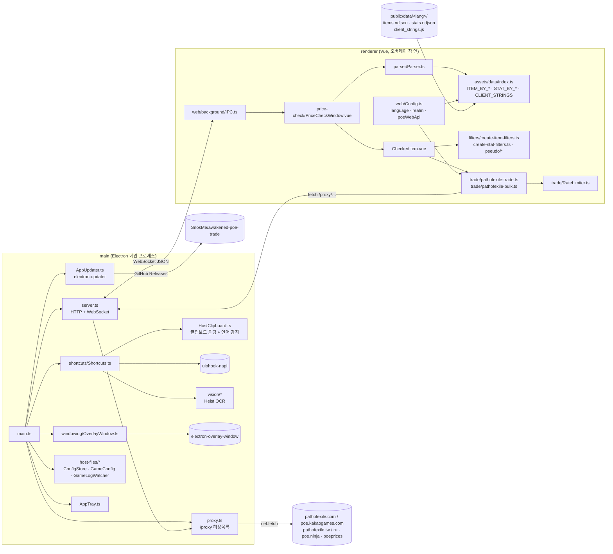

# 01. 아키텍처 분석

- 작성: Claude Code (Architect) · PHASE 0 정적 분석 · 2026-11-17
- 기준 커밋: `3188208` (fork HEAD, 2026-09-25) — upstream `SnosMe/awakened-poe-trade` `b6792c9`(2026-11-17)보다 **1커밋 뒤**, fast-forward 가능
- 표기: ✅ 확인된 사실(코드로 확인) · 🔶 추정 · ❓ 미검증

---

## 1. 기술 스택 ✅

| 영역 | 내용 | 근거 |
|---|---|---|
| 언어 | TypeScript (main, renderer, ipc), Vue SFC | `main/tsconfig.json`, `renderer/tsconfig.json` |
| 데스크톱 런타임 | Electron `^40.10.6` | `main/package.json` |
| UI | Vue `3.2.37`, vue-i18n `^10`, Tailwind 3, Vite `^5` | `renderer/package.json` |
| 네이티브 모듈 | `uiohook-napi 1.5.5`(전역 키보드/마우스 후킹·키 입력 합성), `electron-overlay-window 4.1.0`(게임 창 추적 오버레이) | `main/package.json` |
| 번들러 | main: esbuild (`main/build/script.mjs`), renderer: Vite | |
| 패키징/업데이트 | electron-builder `^26.9`, electron-updater `^6.8` | `main/electron-builder.yml`, `main/src/AppUpdater.ts` |
| 패키지 매니저 | **npm**, `main/`과 `renderer/`가 **각각 독립된 package.json + package-lock.json** (워크스페이스 아님) | |
| 테스트 | **렌더러/파서 자동화 테스트 없음.** 유일한 테스트는 `main/build/apprun-patch.test.mjs`(빌드 패치 검증) | `git ls-files` |
| 문서 사이트 | VitePress (`docs/`), `pages.yml` 워크플로로 GitHub Pages 배포 | |
| 번역 | Crowdin (`crowdin.yml`) — UI 문자열 `renderer/public/data/*/app_i18n.json` | |

버전: `main/package.json` `version: 3.29.108` — 앱 버전이 **PoE 리그 버전(3.29)을 앞자리로 사용**한다.

## 2. 디렉터리 구조와 역할 ✅

```
ipc/                 main ↔ renderer 공용 타입 (IpcEvent, Config 이벤트, 키코드 매핑)
main/                Electron 메인 프로세스
  src/main.ts          진입점: 단일 인스턴스 락, sandbox, 모듈 조립
  src/server.ts        로컬 HTTP + WebSocket 서버 (렌더러 정적 파일, /config, IPC 버스)
  src/proxy.ts         /proxy/<host>/… → 허용 목록 호스트로 net.fetch 중계 (CORS 우회)
  src/shortcuts/       전역 단축키(globalShortcut) + uiohook, 클립보드 폴링, 채팅/창고 검색 입력
  src/windowing/       게임 창 추적, 오버레이 창(BrowserWindow), 표시/숨김
  src/host-files/      설정 저장(ConfigStore), 게임 설정 ini, Client.txt 로그 감시, 파일 업로드
  src/vision/          Heist 젬 OCR (WASM 워커, Windows 전용)
  src/AppUpdater.ts    electron-updater 래퍼
  src/AppTray.ts       트레이 아이콘/메뉴
  build/               esbuild 스크립트, electron-builder 패치(patch-package), 아이콘
renderer/            Vue 앱 (오버레이 UI 전체 + 모든 비즈니스 로직)
  src/parser/          ★ 아이템 텍스트 파서 (언어 독립 설계, CLIENT_STRINGS 기반)
  src/assets/data/     ★ 아이템/스탯 DB 로더 (ndjson + fnv1a 해시 인덱스)
  src/web/price-check/ ★ 필터 생성, 거래소 요청(trade/bulk), 결과 UI
  src/web/…            위젯들: item-check, map-check, item-search, stash-search, stopwatch, settings
  public/data/<lang>/  ★ 언어별 정적 데이터: items.ndjson, stats.ndjson, client_strings.js, app_i18n.json
docs/                VitePress 사용자 문서
.github/workflows/   main.yml(빌드/릴리스), pages.yml(문서)
```

## 3. 프로세스·통신 구조 ✅

이 앱은 **Electron의 `ipcMain`/`ipcRenderer`를 쓰지 않는다.** 메인 프로세스가 `127.0.0.1`의 임의 포트에 HTTP 서버를 띄우고, 오버레이 `BrowserWindow`가 그 URL을 로드하며, **WebSocket으로 JSON 이벤트(`IpcEvent`)를 주고받는다.**

- 서버 기동: `main/src/server.ts:78` `startServer()` — 기본 `127.0.0.1:0`(임의 포트), `--listen=[host][:port]` 인자로 변경 가능(`server.ts:113-118`)
- 이벤트 송신: `server.ts:46` `sendEventTo('broadcast' | 'last-active', …)`
- 렌더러 측: `renderer/src/web/background/IPC.ts` — WebSocket(`sockette`) 클라이언트, `Host.proxy()`는 `fetch('/proxy/<url>')` (`IPC.ts:74-75`)
- 이벤트 이름 규약: `MAIN->CLIENT::*`, `CLIENT->MAIN::*`, `MAIN->OVERLAY::*` (`ipc/types.ts`)
- 렌더러가 브라우저에서도 동작하도록 설계됨: `IPC.ts:79` `navigator.userAgent.includes('Electron')` 분기 → **"웹 버전"이 존재**하며 오버레이 전용 이벤트는 무시

메인 프로세스는 "얇은 호스트"(OS 연동: 키보드, 클립보드, 창, 파일, 프록시)이고, **아이템 인식·필터·거래 로직은 전부 렌더러에 있다.** PoE 3.30 대응과 한국어 지원의 작업 대부분은 렌더러 + 데이터 파일에서 일어난다.

## 4. 모듈 의존 관계



## 5. Windows 플랫폼 종속 코드 ✅

| 위치 | 내용 |
|---|---|
| `main/src/shortcuts/Shortcuts.ts:216` `pressKeysToCopyItemText()` | uiohook으로 `Ctrl` down → `C` tap → up 합성. macOS만 분기 |
| `main/src/shortcuts/HostClipboard.ts` | Linux(KDE, Proton) 우회 분기, Windows는 기본 경로 |
| `main/src/main.ts:22` | macOS 외 플랫폼에서 하드웨어 가속 비활성화 |
| `main/src/vision/*`, `Shortcuts.ts` `ocr-text` | Heist 젬 OCR은 `win32` 전용 |
| `main/src/windowing/*` | `electron-overlay-window`(네이티브)로 게임 창 추적 — 창 제목 `windowTitle` 설정 기반 |
| `main/build/app-builder-lib+26.8.1.patch` | electron-builder 패치 (Linux AppImage 관련으로 보임 🔶 — 상세는 04 문서) |

## 6. 데이터 파이프라인 (중요) ✅/🔶

- `renderer/public/data/<lang>/items.ndjson`, `stats.ndjson`, `client_strings.js`는 **git에 커밋된 정적 산출물**이다. 커밋 `543423a update data`(2026-09-09)처럼 upstream 작성자가 일괄 갱신한다.
- 빌드 시 `renderer/src/assets/make-index-files.mjs`가 이를 읽어 fnv1a 해시 인덱스(`*.index.bin`, gitignore 대상)를 생성한다 (`vite-plugin-make-indexes.ts`).
- 런타임에는 `assets/data/index.ts:192` `init(lang)` → `loadForLang()`이 `fetch()`로 로드한다 (원격 아님, 로컬 서버의 정적 파일).
- **❗ ndjson을 생성하는 도구는 이 저장소에 없다.** 🔶 upstream 작성자의 별도 도구(게임 클라이언트 GGPK/번들의 `.datc64` 테이블 + 공식 거래소 `/api/trade/data/stats` 등을 조합)로 추정. → **독립 유지보수의 최대 공급망 리스크**(06 문서 참조).

## 7. 설계상 강점과 문제점

**강점** ✅
1. 파서가 처음부터 **언어 중립적으로 설계**되어 있다. 모든 고정 문구는 `CLIENT_STRINGS`(`client_strings.js`)에서 오고, 아이템·스탯은 `name`(번역명) ↔ `refName`/`ref`(영문 기준 키) ↔ `trade.ids`(거래소 ID)로 매핑된다. 마스터 프롬프트 PHASE 3의 "언어별 파서 → 공통 모델 → Stat ID" 구조가 **이미 구현되어 있다.**
2. 메인 프로세스가 얇아서 리그 대응 시 메인 쪽 수정이 거의 없다.
3. 데이터가 ndjson + 해시 인덱스여서 수천 줄 데이터를 빠르게 조회한다.

**문제점 / 위험**
1. **자동화 테스트 부재** ✅ — 파서 회귀를 잡을 수단이 없다. Fixture 기반 테스트 하네스(vitest 등) 신설이 PHASE 2의 선행 조건.
2. **데이터 생성기 부재** ✅ — 리그 갱신이 upstream의 데이터 커밋에 의존한다.
3. **upstream이 활발히 유지 중** ✅ (오늘 2026-11-17에도 `support new textual ranges` 커밋). 단 **사용자 결정(2026-11-17): upstream을 추종·병합하지 않고 독자 노선으로 간다.** → 데이터 갱신·파서 보수를 모두 자체적으로 책임져야 하며, upstream 변경은 참고만 한다(필요 시 라이선스 고지를 유지한 채 선별 반영).
4. 렌더러가 로컬 HTTP로 서빙되고 WebSocket에 인증이 없음 🔶 — 보안 상세는 `05-security-audit.md`(Codex 작성).
5. 원본과 같은 앱 이름/ID/업데이트 경로 — 동시 설치 충돌 가능, 상세는 `04-build-and-update.md`(Codex 작성).
