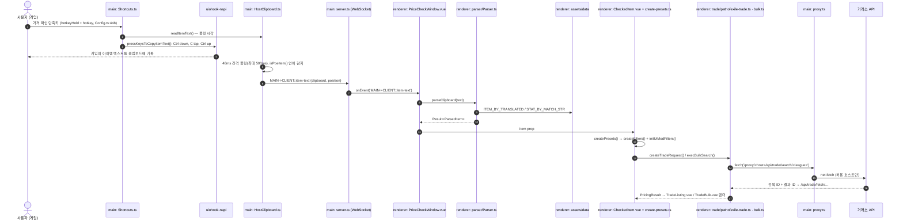

# 02. 아이템 인식 시스템 분석

- 작성: Claude Code (Architect) · PHASE 0 정적 분석 · 2026-11-17
- 표기: ✅ 확인된 사실(코드로 확인) · 🔶 추정 · ❓ 미검증(실행/실제 샘플 미확인)
- **이 문서의 모든 흐름은 코드 정적 분석으로 추적한 것이며, 앱을 실행해 확인하지 않았다.**

---

## 1. Ctrl+C → 가격 표시 전체 흐름

### 단계별 상세

| # | 단계 | 함수 / 파일:라인 | 핵심 데이터 | 비고 |
|---|---|---|---|---|
| 1 | 전역 단축키 | `Shortcuts.register()` `main/src/shortcuts/Shortcuts.ts:129` → `globalShortcut.register()` | `ShortcutAction { shortcut, action: { type: 'copy-item', target: 'price-check' } }` | 게임 예약키(`Ctrl+C`, `Ctrl+V` 등)는 등록 거부 (`:100-112`) |
| 2 | 키 입력 합성 | `pressKeysToCopyItemText()` `Shortcuts.ts:216` | — | **3.29부터 고급 설명(advanced mod desc)이 항상 복사**되므로 `showModsKey = 'Ctrl'` 고정 (`:217-218`). 즉 `Ctrl+C`만 전송 |
| 3 | 클립보드 획득 | `HostClipboard.readItemText()` `main/src/shortcuts/HostClipboard.ts:30` | `string` | 기존 클립보드가 아이템이면 비움. 48ms×최대 500ms 폴링. `restoreClipboard` 옵션 시 이전 내용 복원 |
| 3a | 아이템 여부/언어 감지 | `isPoeItem()` `HostClipboard.ts:105`, `LANGUAGE_DETECTOR` `:109` | 첫 줄 접두사 | `ko` = `'아이템 종류: '` ✅. 감지 결과(lang)는 **단지 아이템 여부 판정**에만 쓰이고 파서 언어 선택에는 쓰이지 않음 |
| 4 | 렌더러 전달 | `server.sendEventTo('last-active', { name: 'MAIN->CLIENT::item-text', … })` `Shortcuts.ts:163-167` | `{ target, clipboard, position, focusOverlay }` | WebSocket JSON |
| 5 | 수신 | `PriceCheckWindow.vue:154` | | 오버레이 영역 추적 요청 후 `parseClipboard()` 호출 (`:184`) |
| 6 | 섹션 분할 | `itemTextToSections()` `renderer/src/parser/Parser.ts:137` | `string[][]` | `--------` 구분선 기준 |
| 7 | 이름판(nameplate) | `parseNamePlate()` `Parser.ts:348` | `ParserState { rarity, category, name, baseType }` | `_$.ITEM_CLASS`, `_$.RARITY`, `_$.RARITY_*` 문자열로 Rarity 판별 |
| 8 | 섹션 파서 체인 | `parsers` 배열 `Parser.ts:32-90`, 실행 루프 `:110-130` | | 각 섹션은 최대 1개 파서가 소비 (`SECTION_PARSED` / `SECTION_SKIPPED` / `PARSER_SKIPPED`) |
| 9 | 종류/베이스 판별 | `parseCategoryByHelpText` `:973`, `normalizeName` `:157`, `findInDatabase` `:180`, 매직 이름 → 베이스 `magicBasetype()` `parser/magic-name.ts` | `item.info: BaseType`, `item.infoVariants` | **번역명(`name`)으로 DB 조회 → `refName`(영문 키) 획득** |
| 10 | 아이템 레벨 등 | `parseItemLevel` `:473`, `parseGem` `:509`, `parseArmour`, `parseWeapon`, `parseStackSize` `:545`, `parseSockets` `:561`, `parseMap` `:260`, `parseInfluence` `:408`, `parseCorrupted` `:442` … | `ParsedItem` 필드 | 모두 `_$.*` 접두사 비교 |
| 11 | 옵션(모드) | `parseModifiers` `Parser.ts:796` (enchant/scourge/implicit/explicit 4회 등록) → `parseModInfoLine` `parser/advanced-mod-desc.ts:25` → `parseStatsFromMod` `Parser.ts:1202` → `tryParseTranslation` `parser/stat-translations.ts:135` | `ParsedModifier { info: { type, generation, tier, rank, name, tags }, stats: ParsedStat[] }` | `{ Prefix Modifier "Name" (Tier: 1) — Tags }` 형식의 정보줄을 `_$.MODIFIER_LINE` 정규식으로 파싱. 스탯 줄은 숫자를 `#`로 바꾼 매처 문자열을 `STAT_BY_MATCH_STR_V2`로 조회 |
| 12 | 후처리(virtual) | `augmentModifiers` `:1239`, `transformToLegacyModifiers` `:1262`, `parseFractured`, `pickCorrectVariant` `:304`, `calcDisenchantDust`, `calcBasePercentile` | `item.statsByType` | 동일 이름 아이템 변형(유니크 변형 등) 확정 |
| 13 | 필터 생성 | `createPresets()` `price-check/filters/create-presets.ts` ← `CheckedItem.vue:119` → `createFilters()` `create-item-filters.ts:23`, `initUiModFilters()` `create-stat-filters.ts:138`, pseudo 규칙 `filters/pseudo/*` | `ItemFilters`, `StatFilter[]` | `useEn: AppConfig().useIntlSite` (`CheckedItem.vue:125`) → 이름을 `refName`(영문) 또는 `name`(번역)으로 선택 (`create-item-filters.ts:507` `t()`) |
| 14 | API 선택 | `apiToSatisfySearch()` `trade/common.ts` | `'trade' \| 'bulk'` | 활성 스탯 필터 없고 `tradeTag` 있으면 bulk(exchange) |
| 15 | 요청 생성 | `createTradeRequest()` `trade/pathofexile-trade.ts:264` / `pathofexile-bulk.ts:119` | `TradeRequest { query: { name, type, stats[], filters } }` | 스탯은 `stat.trade.ids[type]`(예: `explicit.stat_xxx`)로 변환 — **언어 무관 ID** |
| 16 | 거래소 호출 | `requestTradeResultList()` `pathofexile-trade.ts:762` → `/api/trade/search/<league>`; `requestResults()` `:796` → `/api/trade/fetch/<ids>`; `execBulkSearch()` `pathofexile-bulk.ts:140` → `/api/trade/exchange/<league>` | | `Host.proxy()` → main `proxy.ts` 허용목록. Rate limit: `trade/RateLimiter.ts`, 응답 헤더로 `adjustRateLimits` |
| 17 | 엔드포인트 | `poeWebApi()` `renderer/src/web/Config.ts:86` | | `en`→`www.pathofexile.com`, `ko`→`poe.kakaogames.com`, `ru`→`ru.pathofexile.com`, `cmn-Hant`→`pathofexile.tw`; `useIntlSite`면 항상 `www` |
| 18 | 결과 표시 | `TradeListing.vue:162-194`, `TradeBulk.vue:142-173`, 시세 추세 `trends/PriceTrend.vue`(poe.ninja), 가격 예측 `price-prediction/poeprices.ts` | `PricingResult[]` | |

## 2. 데이터 출처 ✅

| 데이터 | 형태 | 출처 | 런타임 로드 |
|---|---|---|---|
| 베이스/유니크/젬/카드/지도 영역 | `public/data/<lang>/items.ndjson` (약 4,980행) | **upstream이 생성해 커밋한 정적 파일** (생성기 미포함) | `assets/data/index.ts:77` `loadItems()` |
| 스탯 매처 + 거래소 ID | `public/data/<lang>/stats.ndjson` (약 9,160행) | 동일 | `index.ts:109` `loadStats()` |
| 클라이언트 고정 문구 | `public/data/<lang>/client_strings.js` (143행, 언어간 키 동일) | 수작업 + 생성 🔶 | `index.ts:219` `loadForLang()`; 영문은 `CLIENT_STRINGS_REF`로 항상 추가 로드 |
| 해시 인덱스 | `*.index.bin` | **빌드 시 생성** `assets/make-index-files.mjs` (언어 목록 하드코딩 `:11`) | |
| 리그 목록 | 거래소 `/api/leagues` | **외부 API (런타임)** `web/background/Leagues.ts:53` | |
| 시세 | poe.ninja | 외부 API (런타임) `web/background/Prices.ts` | `pc-ggg` + 인기 리그만 (`Prices.ts:43`) |

핵심 레코드 구조 (`assets/data/interfaces.ts`):

- `BaseType { name(번역), refName(영문 키), namespace, tradeTag?, tradeDisc?, disc?, craftable?, unique?, gem?, armour? … }`
- `Stat { ref(영문 키), matchers: [{ string, advanced?, negate?, value? }](번역 매처), better, trade: { ids: { explicit: [...], implicit: [...], pseudo: [...] … } } }`

즉, **파서는 언어별 문자열을 받아 영문 키(`refName`/`ref`)와 거래소 ID로 정규화한다.** 거래소 검색은 스탯 ID와(옵션에 따라) 번역명 또는 영문명으로 수행된다.

## 3. 특수 아이템/리그 전용 처리 ✅

파서 체인에 리그·메커니즘 전용 파서가 다수 존재한다 (`Parser.ts:32-90`): Heist(`parseHeistContract`, `parseHeistBlueprint`), Sentinel, Atzoatl(`parseAtzoatlRooms`), Mirrored Tablet, Filled Coffin(`:1173`), Scrying Orb(`:898`), Mercenary(`parseMercenary` `:744`, `parseMercenaryGems`), Logbook, Chart, Tincture, Talisman, Foil, Imbued Gem, Eldritch 임플리싯(`parseEldritchItem` `:913` — upstream 버그 우회) 등.
필터 쪽은 `filters/pseudo/*`(atzoatl-rules, heist, mercenary, maps, timeless-jewel, reflection-rules 등)와 `create-item-filters.ts`의 `refName` 분기(`'Scrying Orb'`, `'Charged Compass'`, `'Chronicle of Atzoatl'`, `'Mirrored Tablet'`, `'Forbidden Tome'` 등)가 담당한다.

→ **3.30 신규 메커니즘은 (a) 데이터 갱신만으로 되는 것, (b) 새 파서/필터가 필요한 것으로 나뉜다.** 기존 패턴(파서 함수 1개 + `parsers` 배열 등록 + 필요 시 `client_strings` 키 + pseudo 필터)을 그대로 따르면 된다.

## 4. 3.30 대응 시 수정 지점 (Q2 답변)

| 우선 | 대상 | 이유 |
|---|---|---|
| ★★★ | `renderer/public/data/{en,ko,ru,cmn-Hant}/items.ndjson`, `stats.ndjson` | 신규 베이스/유니크/젬/스탯 및 거래소 ID. **가장 큰 작업량이자 가장 큰 리스크(생성기 부재)** |
| ★★★ | `client_strings.js` (전 언어) | 신규 아이템 섹션 문구(새 속성 줄, 새 정보줄 키워드) |
| ★★ | `parser/Parser.ts` 파서 체인 + `ParsedItem.ts` | 새 섹션 형식/속성. 기존 패턴 재사용 |
| ★★ | `parser/stat-translations.ts`, `advanced-mod-desc.ts` | 복사 텍스트 형식 변경 대응 (upstream이 오늘 `(...)` 텍스트 범위 지원 추가 — 3.30 대비로 추정 🔶) |
| ★★ | `price-check/filters/create-item-filters.ts`, `pseudo/*`, `trade/pathofexile-trade.ts` | 신규 거래소 카테고리/필터(`CATEGORY_TO_TRADE_ID`), 신규 속성 필터 |
| ★ | `parser/meta.ts` (`ItemCategory`) | 신규 아이템 분류 |
| ★ | `assets/make-index-files.mjs`, `Leagues.ts`(`id.includes('Ruthless')` 등) | 리그 이름 처리 |
| ★ | `main/src/shortcuts/Shortcuts.ts:216` | 복사 키 동작이 3.30에서 또 바뀌는 경우에만 |

**❓ 3.30의 실제 변경 내용은 PHASE 1에서 공식 패치 노트·거래소 데이터로 검증 전까지 확정하지 않는다.**

## 5. 회귀 위험 지점

1. **파서 체인 순서 의존성** — 한 섹션은 한 파서만 소비. 새 파서를 잘못된 위치에 넣으면 기존 섹션을 가로챈다.
2. **`STAT_BY_MATCH_STR` 해시 충돌** — fnv1a 32bit 충돌 시 `undefined` 반환(`index.ts:130-135`). 스탯 수 증가 시 드물게 발생 가능.
3. **`init()`의 지연 검증** (`index.ts:199-215`) — 코드의 `stat('…')` 참조가 새 데이터에 없으면 **앱 초기화 단계에서 throw** → 데이터 갱신 후 앱이 아예 안 뜰 수 있음. 데이터 교체 시 반드시 전 언어 로드 테스트 필요.
4. **테스트 부재** — 위 모든 위험을 자동으로 잡을 수단이 없다.
